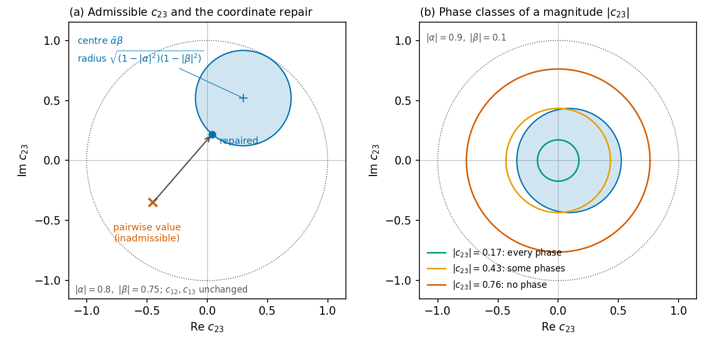

# Ordered Cholesky coordinates for three-component coherence

Python tools for the time–frequency coherence matrix of three-component ground motions: estimation, bias correction, repair, fitting and simulation. The ordered-coordinate correction and fitting preserve admissibility, that is, positive semidefiniteness. Pairwise methods are included for comparison and can produce inadmissible matrices before repair.



## Contents

1. [The method](#1-the-method)
2. [Installation](#2-installation)
3. [Quick start](#3-quick-start)
4. [Modules](#4-modules)
5. [Examples](#5-examples)
6. [Tests](#6-tests)
7. [License](#7-license)

## 1. The method

### 1.1 Why pairwise treatment fails

At one time–frequency point, the coherence of the vertical component (1) and the two horizontal components (2, 3) is a Hermitian matrix with unit diagonal:

$$C = \begin{pmatrix} 1 & c_{12} & c_{13} \\ \bar{c}_{12} & 1 & c_{23} \\ \bar{c}_{13} & \bar{c}_{23} & 1 \end{pmatrix}$$

Only positive semidefinite matrices describe real motions. When the three coherences are estimated, corrected or modelled one pair at a time, each can be plausible on its own while the three together are impossible.

### 1.2 Ordered coordinates

The method writes C in three ordered coordinates:

$$\alpha = c_{12},\qquad \beta = c_{13},\qquad \delta = \frac{c_{23} - \bar{\alpha}\,\beta}{\sqrt{(1-|\alpha|^2)(1-|\beta|^2)}}$$

Here δ is the partial coherence of the two horizontal components given the vertical one. The inverse map is

$$c_{23} = \bar{\alpha}\,\beta + \delta\sqrt{(1-|\alpha|^2)(1-|\beta|^2)}$$

It gives an admissible matrix for every |α|, |β|, |δ| ≤ 1, and every admissible matrix has such coordinates. The coordinates parameterize the Cholesky factor of C taken in the order vertical, first horizontal, second horizontal. In these coordinates, the admissible set is the product of three unit discs.

### 1.3 Geometry

For given c12 and c13, the admissible values of c23 fill a disc with centre ᾱβ and radius √((1−|α|²)(1−|β|²)) (figure, panel a). Whether a magnitude |c23| is admissible therefore depends on its phase (panel b):

- If the circle |c23| = h lies inside the disc, every phase is admissible.
- If it crosses the disc, only some phases are admissible.
- If it misses the disc, no phase is.

Pairwise models that set magnitudes and phases separately are safe only in the first class. `phase_class` reports the class of each matrix.

### 1.4 What the coordinates make possible

| Task | How the package does it |
| --- | --- |
| Estimation | STFT of the three components; local spectral matrix averaged with one common set of positive weights (5 frequency bins × 5 frames); exact normalization by the diagonal. The estimate is admissible by construction. |
| Bias correction | A smoothed estimate overstates coherence. Surrogates preserve each component's STFT magnitudes while randomizing phases independently, then undergo synthesis and re-analysis. Their mean squared coherence estimates a surrogate floor for the correction. Corrected in α, β and δ, the matrix stays admissible; corrected pair by pair, it may not. |
| Repair | The coordinate repair keeps c12 and c13 and moves c23 radially onto the disc, in closed form. For comparison, the package also has Higham projection, shrinkage toward the identity and eigenvalue clipping, which change all three coherences. |
| Fitting | Smooth fields of α, β and δ, given as basis expansions and mapped into the unit disc, are admissible for every parameter vector. An unconstrained optimizer (BFGS) can therefore fit them without a repair inside the objective. A pairwise formulation repaired by Higham projection is included for comparison. |
| Simulation | The lower-triangular factor of the local spectral matrix is written directly in the coordinates. Independent Gaussian drivers on the time–frequency atoms, passed through this factor and the inverse STFT, give motions with the prescribed marginal spectra and coherence. |
| Checking simulations | Overlap-add synthesis and re-analysis do not return the prescribed matrix exactly. `realized_target` computes the expected local spectral matrix. Compare its normalized coherence with the normalized pooled spectral estimate of simulations. |
| Response | Pseudo-acceleration response spectra of each component, their geometric mean, RotD50 and RotD100. |

## 2. Installation

Python 3.9 or later with NumPy and SciPy:

```bash
pip install -r requirements.txt
```

The package is the folder `ordered_cholesky/`. Put the repository root on the Python path, or run the examples from it.

## 3. Quick start

```python
import ordered_cholesky as oc

acc, dt = oc.preprocess(*oc.read_record('H1.AT2', 'H2.AT2', 'V.AT2'))   # vertical first, dt = 0.01 s
freqs, times, z = oc.stft(acc, dt)
s = oc.local_spectra(z)                                  # (n_freq, n_time, 3, 3)
c = oc.coherence(s)                                      # admissible estimate

floor = oc.surrogate_floor(acc, dt, n_surrogates=20, seed=0)
c_corrected = oc.correct_coherence(c, floor)             # bias-corrected, still admissible

alpha, beta, delta = oc.to_coordinates(c_corrected)
c_model = oc.from_coordinates(alpha, beta, 0.8 * delta)  # any change inside the unit discs stays admissible

c_pairwise = oc.correct_coherence(c, floor, method='pairwise')   # may leave the admissible set
c_fixed = oc.coordinate_repair(c_pairwise)               # repaired; c12 and c13 unchanged
motions = oc.simulate(s, c_model, dt, n_samples=10, seed=1)
```

## 4. Modules

| Module | Functions |
| --- | --- |
| `estimation` | `stft`, `istft`, `local_spectra`, `coherence`, `energy_weights` |
| `coordinates` | `to_coordinates`, `from_coordinates`, `assemble`, `disc`, `phase_class`, `min_eigenvalue` |
| `correction` | `surrogate_floor`, `phase_surrogate`, `correct_magnitude`, `correct_coherence` |
| `repair` | `coordinate_repair`, `higham_projection`, `shrink_to_identity`, `eigenvalue_clipping` |
| `fitting` | `fit_coherence`, `fields_from_parameters`, `bilinear_basis`, `grid_indices`, `to_unit_disk` |
| `simulation` | `ordered_factor`, `simulate`, `realized_target` |
| `response` | `sdof_response`, `response_spectra` |
| `records` | `read_at2`, `read_record`, `preprocess` |

The defaults are a Hann window with 128-point segments, 96-point overlap and a 256-point FFT at a 0.01 s time step. The preprocessing is a linear detrend, a 2 % cosine taper and a 0.1–12 Hz Butterworth band-pass. Every function documents its arguments.

## 5. Examples

Each example takes the three AT2 files of one record (the two horizontal components, then the vertical one):

```bash
python examples/01_coherence_and_coordinates.py H1.AT2 H2.AT2 V.AT2
python examples/02_fit_in_coordinates.py H1.AT2 H2.AT2 V.AT2
python examples/03_simulation.py H1.AT2 H2.AT2 V.AT2
```

| Example | What it shows |
| --- | --- |
| `01_coherence_and_coordinates.py` | The estimate and its coordinates; the surrogate floor; inadmissible energy after pairwise and coordinate bias correction; phase classes; how far each repair moves c12 and c13 |
| `02_fit_in_coordinates.py` | A smooth field fitted on a 6 × 6 grid in the coordinates and in the pairwise formulation with Higham projection: error, iterations and CPU time |
| `03_simulation.py` | Twenty simulated motions: their coherence against the realized and the prescribed target, and their response spectra against the record's |

### 5.1 Ground-motion records

The records are not included, because they cannot be redistributed. Download them from the PEER NGA-West2 database at <https://ngawest2.berkeley.edu>, which asks users to register with a university or corporate email address. Search by record sequence number (RSN) and download the unscaled time series (AT2 files).

`records/record_list.csv` lists 100 three-component records with their RSNs and AT2 file names. `records/rsn_list.txt` holds the same RSNs for the search form.

## 6. Tests

```bash
pip install -r requirements-dev.txt
python -m pytest tests
```

The development requirements also include Matplotlib for `python docs/make_figure.py`.

The tests use synthetic data and cover the following:

- the coordinates and their inverse;
- admissibility of the estimate, the corrections, the repairs and the fits;
- the phase classes;
- the ordered factor;
- agreement of simulated motions with the realized target.

## 7. License

MIT License; see `LICENSE`. `docs/make_figure.py` draws the figure above.
